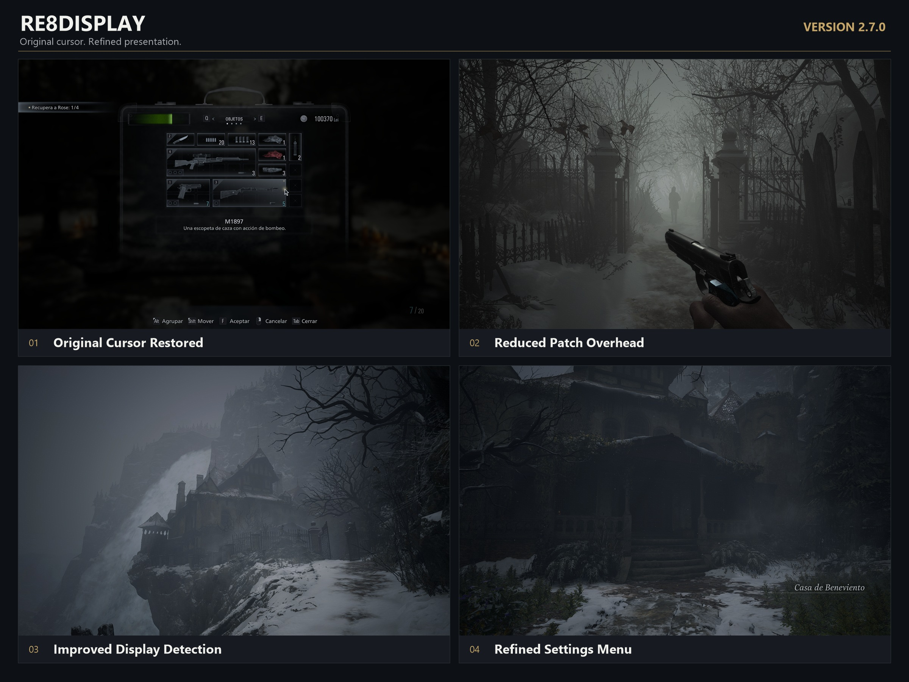

# Resident Evil Village — RE8Display v2.7.0

**The original cursor returns. Display handling becomes more adaptable. Configuration becomes easier.**

RE8Display is an independent [REFramework](https://github.com/praydog/REFramework) plugin for **Resident Evil Village** on Windows. It improves aspect ratio handling, camera field of view, proportional interface scaling, and cursor behavior while keeping its configuration separate from the framework host.

Version **2.7.0** focuses on a more natural interaction with the game: the original cursor is restored, unnecessary patch updates are reduced, and the settings menu provides clearer control over your experience.

**[Downloads and releases](https://github.com/XssentialPilar/Resident-Evil-8-Village-Aspect-Ratio-Patch-/releases)** · **[Installation guide](ReadMe%20v2.7.0_%28General%29.txt)** · **[Validation and scope](docs/audit-2.7.0.md)**

## What's New in 2.7.0

### Original Game Cursor, Restored

The game's original cursor and visual effects are **enabled by default**. Its displayed position now follows the absolute Windows mouse position, addressing the offset observed in earlier builds while preserving its proportions and appearance.

The correction maps client coordinates to the actual rendered output and uses a dedicated cursor canvas to avoid applying interface scaling twice. Native clicks and game actions remain in place. If you prefer the Windows pointer alone, you can select that behavior in the settings menu.

### Less Repeated Work

Camera and interface properties are updated when their values differ, and shared interface roots receive fewer repeated adjustments. Configuration changes are saved in the background after a short pause in editing, reducing disk activity while moving sliders.

These changes reduce the patch's own overhead. They are not a promise of a particular FPS increase or the elimination of stuttering from the game, drivers, or other mods.

### Clearer Settings and a Complete Reset

The ImGui menu groups related options into sections and provides a full-width FOV slider, cursor controls, and display information. Its bounded, scrollable layout keeps settings accessible on smaller outputs.

**Restore All Defaults** resets every patch option, including automatic FOV handling, cursor mode, and the default menu shortcut. You can experiment with settings and return to the original configuration in one step.

### Improved Display Detection

The patch uses the actual DXGI backbuffer dimensions when available, with a swap-chain descriptor fallback. Monitor dimensions are reported separately so that monitor mode and rendering resolution are not treated as interchangeable.

Resolution, window, display, device-reset, and DPI changes trigger a refresh. During steady operation, detection is polled at a limited rate to avoid unnecessary work.

## In-Game Overview



*Original gameplay screenshots arranged into a release overview. The captions highlight this version's main changes.*

## Core Features

- **Automatic aspect ratio and FOV adjustment:** Corrections are calculated from the active output dimensions rather than a fixed list of resolutions. Automatic FOV handling preserves native camera and aiming changes.
- **Proportional interface scaling:** Screen-space interface roots use uniform resolution adjustment, helping preserve the proportions of their contents.
- **Targeted menu cursor handling:** Exact menu identifiers and typed GUI drivers cover supported interfaces, including the Duke's shop, inventory, map, and typewriter save lists. HUD and autosave notifications do not independently enable the menu pointer.
- **Independent controls:** Display correction and cursor control can be enabled or disabled separately.
- **Private configuration:** Settings are stored in `reframework/data/RE8Display.ini`, with an independent, rebindable menu shortcut.

**Map controls remain the game's original controls.** This release does not add a separate map-dragging system.

## Requirements

| Component | Requirement |
| --- | --- |
| Game | Resident Evil Village for Windows |
| Architecture | Windows x64 |
| Framework | An unmodified REFramework host exposing **plugin API 1.15 or newer** |
| Main package | `RE8Display-2.7.0.zip` |

Please verify the host's plugin API compatibility before installing. The official [REFramework nightly releases](https://github.com/praydog/REFramework-nightly/releases) are a source for newer builds.

## Installation and Upgrading

1. **Close the game normally.** Back up your existing RE8Display files and private configuration before upgrading.
2. Install or verify a compatible REFramework host.
3. Extract **`RE8Display-2.7.0.zip`** into the game directory containing `re8.exe`. Allow the `reframework` folders to merge.
4. Launch the game and press **`;`** to open **RE8Display Settings**.

The main archive contains exactly three files:

```text
reframework/
├── plugins/
│   ├── RE8Display.dll
│   └── RE8Display.LICENSE.txt
└── data/
    └── RE8Display.ini
```

The compatible REFramework loader, `dinput8.dll`, is installed separately. The main archive supplies the plugin, default settings, and license notices; shared framework settings and game saves are outside its installation scope.

When preserving personal settings, keep your existing `RE8Display.ini` instead of replacing it with the packaged defaults. New options use their built-in defaults when absent from an older configuration.

### Upgrading from an Older Bundled Patch

If your previous patch included a modified or bundled framework host, use that patch's original uninstaller first and retain its backups. Then install or restore a compatible, unmodified REFramework host before adding RE8Display 2.7.0.

Disable REFramework's separate Graphics ultrawide correction and any other mod that writes to the same camera or interface properties. Competing corrections can produce inconsistent results.

## Settings at a Glance

| Setting | Purpose |
| --- | --- |
| **Use original game cursor and effects** | Enabled by default; disable it to use the Windows pointer alone. |
| **Cursor control in game menus** | Enables the patch's menu cursor handling. |
| **Enable display correction** | Controls aspect ratio, camera, and interface corrections. |
| **Override FOV** | Enables an optional horizontal FOV setting from 40° to 120°, referenced to the 16:9 base and adapted to the active aspect ratio. Automatic handling is the default. |
| **Use vertical FOV** | Selects the vertical FOV axis for the corrected camera. |
| **Proportional game interface** | Enables uniform interface adjustment. |
| **Change menu key** | Rebinds the patch's independent shortcut. The default is the `;` character for the active keyboard layout. |
| **Restore All Defaults** | Resets all patch options, including FOV and the menu shortcut. |
| **Cursor diagnostics** | Enables additional logging for troubleshooting. |

The framework host's own menu shortcut remains separate. Please allow a brief moment for configuration changes to be saved before exiting the game.

## Validation and Compatibility

The corrected cursor was confirmed during user gameplay testing. The main patch and both optional modules were also tested together, with no reported loading failures, crashes, or new stuttering during that session.

Validation included:

- **Seven native and ABI test suites**, covering geometry, projection, cursor policy, GUI layout, managed numeric invocation, viewport policy, and plugin compatibility.
- **93 additional checks** covering main-package contents and hashes, installation, rollback, and optional-module installation and recovery.
- Separate DirectStorage tests for native file-I/O behavior, concurrency, timeouts, and recovery from injected failures.

Coordinate tests include 4:3, 16:10, 16:9, ultrawide, 4K, and differing client/backbuffer dimensions. These automated cases do not establish compatibility with every physical display, exclusive scaling configuration, game build, driver, or mod combination. The previously reported water/lighting issue is not certified fixed by this release.

See the [seven-point audit](docs/audit-2.7.0.md) and [validation record](docs/validation-2.7.0.json) for the tested scope and exact binary identities.

## Troubleshooting and Removal

| Symptom | Suggested check |
| --- | --- |
| Plugin does not load | Verify plugin API 1.15+ compatibility and the location of `RE8Display.dll`. |
| Unexpected aspect ratio or FOV | Disable competing camera/interface corrections and try automatic FOV handling. |
| Cursor behavior differs from your preference | Check both cursor options and temporarily enable cursor diagnostics. |
| Menu shortcut does not respond | Check the active keyboard layout or your saved custom binding. |
| Settings changed after an upgrade | Restore your backed-up private INI or use Restore All Defaults. |

To remove the display patch, close RE8 and remove `RE8Display.dll` and `RE8Display.LICENSE.txt` from `reframework/plugins/`. Remove `reframework/data/RE8Display.ini` only if you also want to discard your settings. Keep the framework loader, unrelated mods, and game saves. Optional modules have their own uninstallers.

## Building from Source

The project includes pinned REFramework public SDK and MinHook dependencies. A full framework source checkout is not required.

Use Windows x64, CMake, and Visual Studio 2022 or 2026 C++ Build Tools:

```powershell
.\tools\RE8Display.Build.ps1
.\tools\RE8Display.Test.ps1
.\tools\RE8Display.Package.ps1
```

For Visual Studio 2022, pass `-Generator 'Visual Studio 17 2022'` to the build and test scripts. Package integrity can then be checked using `tests/RE8Display.Package.Tests.ps1` and the generated package directory.

| Directory | Contents |
| --- | --- |
| `native/` | Display plugin and separate technology bridges |
| `config/` | Default private settings |
| `external/` | Pinned dependencies and private local SDK packages |
| `tests/` | Native, installation, recovery, and package checks |
| `tools/` | Build, test, installation, and packaging scripts |
| `docs/` | Guides, validation records, and release artwork |

## Credits and Feedback

**Maintained by [XssentialPilar](https://github.com/XssentialPilar).**

- [REFramework and its SDK](https://github.com/praydog/REFramework) — Praydog and contributors.
- [MinHook](https://github.com/TsudaKageyu/minhook) — API interception dependency.
- **Resident Evil Village** — Capcom.

Required license notices accompany the plugin. No game assets are distributed in the runtime ZIPs.

Thank you for using, testing, and supporting RE8Display. If something does not work as expected, please [report the issue](https://github.com/XssentialPilar/Resident-Evil-8-Village-Aspect-Ratio-Patch-/issues) with your resolution, display mode, REFramework version, installed optional modules, and steps to reproduce it. Clear reports help make each update more reliable for everyone.

## Optional Technology Modules

These are **separate, optional downloads**. The main display patch works without either module. Please follow each module's included installer and removal instructions rather than copying its payload files directly into the game.

### DirectX 12 Agility SDK 722

**Package:** `RE8Agility-722-Game-2.7.0.zip`

This startup bridge selects a private Agility SDK 722 runtime before RE8 creates its graphics device. It records the actual device SDK, highest supported shader model, and DXR tier, making activation and hardware capabilities easier to verify. The new bridge confirmed **SDK 722 on the real game device** during the combined gameplay test.

The module installs its proxy beside `re8.exe` and keeps the private runtime in its own game-local directory. It does not replace Windows system DirectX files. Another mod using the same `d3d12.dll` proxy filename may conflict; the installer checks for conflicting files and creates recovery records.

### DirectStorage 1.4

**Package:** `RE8DirectStorage-1.4-Game-2.7.0.zip`

This bridge sends eligible synchronous, read-only PAK requests through a DirectStorage queue into **CPU memory**. RE8 retains its original decompression and GPU-upload stages. Native fallback, bounded requests, and startup comparisons protect the existing file-I/O behavior.

Version 2.7.0 avoids waiting for the I/O mutex during render-thread collection and removes the verification-lock cost after the initial comparisons. The recorded game test confirmed **22,957 PAK reads, 5.65 GB of data, and 64 successful native comparisons**, with zero recorded verification errors, timeouts, runtime errors, or native compatibility errors.

### Technical Scope and Preview Requirements

Activating a newer runtime does not automatically modernize the game's renderer or assets. These modules **do not integrate clustered geometry, PTLAS, SER, or OMM into RE8**, and they do not implement Zstd/GACL asset conversion, GPU decompression, or CreatorID-based GPU scheduling. They provide the runtime-selection and raw file-I/O functionality described above.

Both installers require the **original matching Microsoft preview package**, which is not redistributed in the module ZIPs. Please review its included terms before installation. No specific FPS increase, VRAM reduction, instantaneous loading, or universal compatibility is promised.
